

<picture><source media="(prefers-color-scheme: dark)" srcset="./assets/hero-dark.svg"></picture>

 

<picture><source media="(prefers-color-scheme: dark)" srcset="./assets/section-journey-dark.svg"></picture>

<picture><source media="(prefers-color-scheme: dark)" srcset="./assets/journey-dark.svg">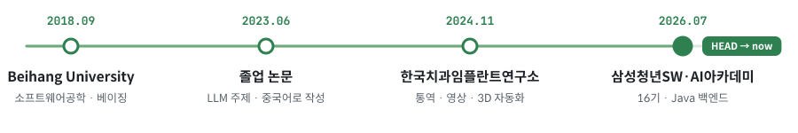</picture>

<picture><source media="(prefers-color-scheme: dark)" srcset="./assets/section-projects-dark.svg"></picture>

<a href="https://github.com/OKKIKKI/KKIRI"><picture><source media="(prefers-color-scheme: dark)" srcset="./assets/project-01-dark.svg"></picture></a>
<picture><source media="(prefers-color-scheme: dark)" srcset="./assets/project-02-dark.svg">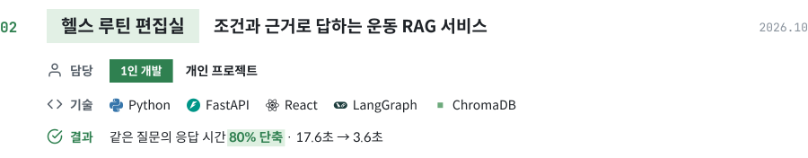</picture>

<a href="https://gwangju-jeolla-nice.netlify.app/"><picture><source media="(prefers-color-scheme: dark)" srcset="./assets/project-03-dark.svg">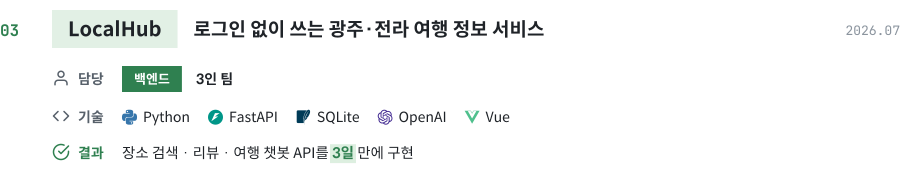</picture></a>
<picture><source media="(prefers-color-scheme: dark)" srcset="./assets/project-04-dark.svg">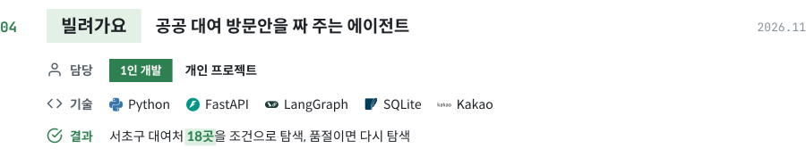</picture>

<picture><source media="(prefers-color-scheme: dark)" srcset="./assets/project-05-dark.svg"></picture>
<picture><source media="(prefers-color-scheme: dark)" srcset="./assets/project-06-dark.svg"></picture>

<picture><source media="(prefers-color-scheme: dark)" srcset="./assets/section-more-dark.svg"></picture>

<a href="https://phone-maker.vercel.app/editor/"><picture><source media="(prefers-color-scheme: dark)" srcset="./assets/project-07-dark.svg">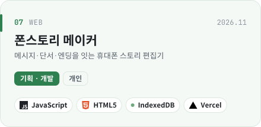</picture></a>
<picture><source media="(prefers-color-scheme: dark)" srcset="./assets/project-08-dark.svg">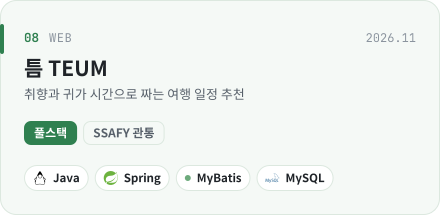</picture>

<picture><source media="(prefers-color-scheme: dark)" srcset="./assets/project-09-dark.svg">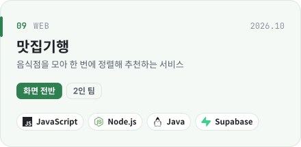</picture>
<picture><source media="(prefers-color-scheme: dark)" srcset="./assets/project-10-dark.svg">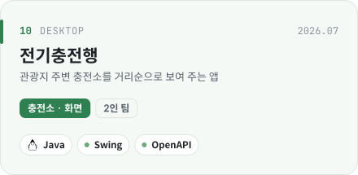</picture>

<picture><source media="(prefers-color-scheme: dark)" srcset="./assets/project-11-dark.svg">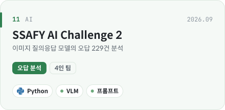</picture>
<picture><source media="(prefers-color-scheme: dark)" srcset="./assets/project-12-dark.svg">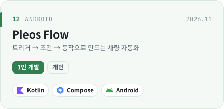</picture>

<picture><source media="(prefers-color-scheme: dark)" srcset="./assets/project-13-dark.svg">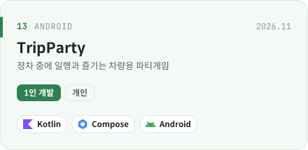</picture>
<picture><source media="(prefers-color-scheme: dark)" srcset="./assets/project-14-dark.svg">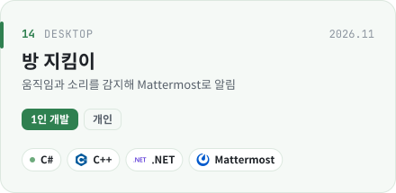</picture>

<picture><source media="(prefers-color-scheme: dark)" srcset="./assets/project-15-dark.svg">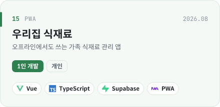</picture>
<picture><source media="(prefers-color-scheme: dark)" srcset="./assets/project-16-dark.svg">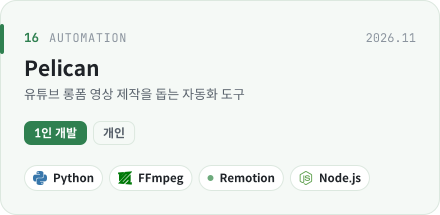</picture>

<picture><source media="(prefers-color-scheme: dark)" srcset="./assets/section-stack-dark.svg"></picture>

<picture><source media="(prefers-color-scheme: dark)" srcset="./assets/stack-dark.svg"></picture>

<picture><source media="(prefers-color-scheme: dark)" srcset="./assets/section-activity-dark.svg"></picture>

<picture><source media="(prefers-color-scheme: dark)" srcset="./assets/activity-dark.svg"></picture>

<picture><source media="(prefers-color-scheme: dark)" srcset="./assets/section-grass-dark.svg"></picture>

<picture><source media="(prefers-color-scheme: dark)" srcset="./profile-3d-contrib/profile-night-green.svg">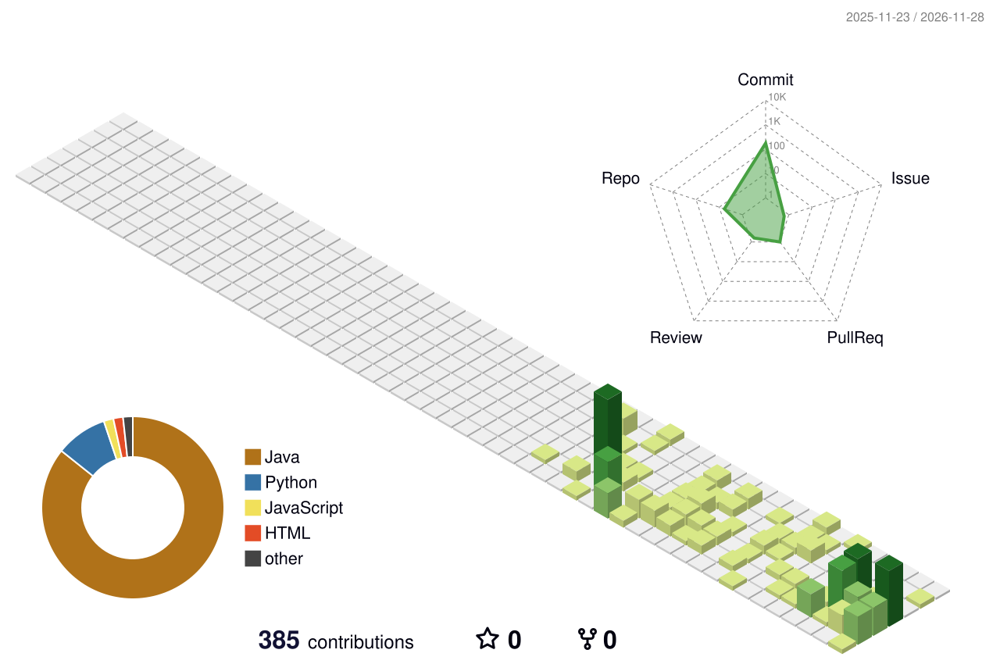</picture>

<!-- 이 파일은 scripts/build.py가 만든다. 내용은 scripts/data.py에서 고치고 python3 scripts/build.py를 실행한다. 잔디 그림은 .github/workflows/profile-3d.yml이 매일 새로 그린다. -->
