<picture><source media="(prefers-color-scheme: dark)" srcset="./assets/hero-dark.svg"></picture>

**Email** [soljinkim13@gmail.com](mailto:soljinkim13@gmail.com)　**Velog** [velog.io/@tongmill_g](https://velog.io/@tongmill_g/posts)

<picture><source media="(prefers-color-scheme: dark)" srcset="./assets/about-dark.svg"></picture>

<picture><source media="(prefers-color-scheme: dark)" srcset="./assets/stack-dark.svg"></picture>

<a href="https://github.com/OKKIKKI/KKIRI"><picture><source media="(prefers-color-scheme: dark)" srcset="./assets/project-1-dark.svg"></picture></a>
<a href="https://github.com/soljinkim13/health-routine-studio"><picture><source media="(prefers-color-scheme: dark)" srcset="./assets/project-2-dark.svg"></picture></a>
<a href="https://github.com/soljinkim13/localhub"><picture><source media="(prefers-color-scheme: dark)" srcset="./assets/project-3-dark.svg"></picture></a>
<a href="https://github.com/soljinkim13/borrow-planner"><picture><source media="(prefers-color-scheme: dark)" srcset="./assets/project-4-dark.svg"></picture></a>
<picture><source media="(prefers-color-scheme: dark)" srcset="./assets/project-5-dark.svg"></picture>
<picture><source media="(prefers-color-scheme: dark)" srcset="./assets/project-6-dark.svg"></picture>

[LocalHub 데모 ↗](https://gwangju-jeolla-nice.netlify.app/)

<picture><source media="(prefers-color-scheme: dark)" srcset="./assets/side-dark.svg"></picture>

저장소: [폰스토리 메이커](https://github.com/soljinkim13/phone-maker) · [틈 TEUM](https://github.com/soljinkim13/teum-enjoytrip) · [맛집기행](https://github.com/soljinkim13/matzip-trip) · [전기충전행](https://github.com/soljinkim13/ev-charge-trip) · [Pleos Flow](https://github.com/soljinkim13/pleos-flow) · [TripParty](https://github.com/soljinkim13/trip-party) · [방 지킴이](https://github.com/soljinkim13/what-you-doin) · [우리집 식재료](https://github.com/soljinkim13/food_manager_plus) · [Pelican](https://github.com/soljinkim13/auto-pelican)

<picture><source media="(prefers-color-scheme: dark)" srcset="./assets/records-dark.svg"></picture>

<picture><source media="(prefers-color-scheme: dark)" srcset="https://raw.githubusercontent.com/soljinkim13/soljinkim13/output/github-snake-dark.svg"></picture>

<picture><source media="(prefers-color-scheme: dark)" srcset="./assets/footer-dark.svg"></picture>

<!-- 이 파일은 scripts/build.py가 만든다. 내용은 scripts/data.py에서 고치고 python3 scripts/build.py를 실행한다. 잔디 뱀 그림은 .github/workflows/snake.yml이 매일 output 브랜치에 새로 그린다. -->
