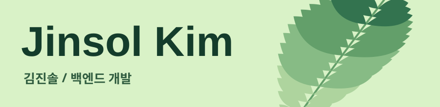

<picture>
  <source media="(prefers-color-scheme: dark)" srcset="./assets/profile-green-night.svg" />
  
</picture>

차량과 모바일 웹이 함께 쓰는 세션 서버를 만들고, 브라우저 안에서 이야기를 편집하고 배포하는 도구를 개발합니다.

## 주요 프로젝트

### KKIRI · 끼리

**백엔드 개발 · 팀장**　|　현대자동차그룹 Pleos 앱 개발 공모전

여러 차에 나눠 탄 일행이 메시지·경유지·음악을 공유하는 앱. 서버가 세션의 입장부터 재접속·종료까지 관리합니다.

**계약·회귀 테스트 18묶음 통과** · 서버 테스트와 차량 앱 목업이 같은 REST·WebSocket 예시 데이터를 사용합니다.

[소스 코드 ↗](https://github.com/OKKIKKI/KKIRI)　[시연 영상 ↗](https://drive.google.com/file/d/1t39sDGqGukPX4RKMDjvrmnzsNmc4bFDK/view?usp=drivesdk)　[API 계약 예시 ↗](https://github.com/OKKIKKI/KKIRI/tree/main/docs/fixtures)

### phone-maker · 폰스토리 메이커

가상 휴대폰 속 메시지와 단서, 선택지와 엔딩을 연결해 인터랙티브 스토리를 만드는 웹 편집기입니다.

**HTML 파일 하나로 플레이** · 편집 중인 작품은 IndexedDB에 자동 저장하고, JSON으로 다시 불러와 이어서 작업할 수 있습니다.

[편집기 열기 ↗](https://phone-maker.vercel.app/editor/)

### KIC AI 에이전트 공모전

**서비스 공동 기획**　|　팀 4상 최고가

## 기술 스택

     

GitHub 활동

