<picture><source media="(prefers-color-scheme: dark)" srcset="./assets/hero-dark.svg"></picture>

**Email** [soljinkim13@gmail.com](mailto:soljinkim13@gmail.com)　**Velog** [velog.io/@tongmill_g](https://velog.io/@tongmill_g/posts)

<picture><source media="(prefers-color-scheme: dark)" srcset="./assets/section-projects-dark.svg"></picture>

<table>
<tr>
<td width="50%" valign="top">
<h3>01&nbsp; KKIRI</h3>
차량 여러 대를 하나로 묶는 실시간 소통 앱  
<b>백엔드 전담</b> · 5인 팀 · 팀장 · 2026.10 – 11 
 TypeScript&nbsp;  Node.js&nbsp; WebSocket&nbsp; REST API 
결과 &nbsp;세션 상태를 <b>4단계</b>로 나눠 통신이 끊겨도 같은 무리로 복귀  

</td>
<td width="50%" valign="top">
<h3>02&nbsp; 헬스 루틴 편집실</h3>
조건과 근거로 답하는 운동 RAG 서비스  
<b>1인 개발</b> · 개인 프로젝트 · 2026.10 
 Python&nbsp;  FastAPI&nbsp;  React&nbsp;  LangGraph&nbsp; ChromaDB 
결과 &nbsp;같은 질문의 응답 시간 <b>80% 단축</b> · 17.6초 → 3.6초  

</td>
</tr>
<tr>
<td width="50%" valign="top">
<h3>03&nbsp; LocalHub</h3>
로그인 없이 쓰는 광주·전라 여행 정보 서비스  
<b>백엔드</b> · 3인 팀 · 2026.07 
 Python&nbsp;  FastAPI&nbsp;  SQLite&nbsp;  OpenAI&nbsp;  Vue 
결과 &nbsp;장소 검색 · 리뷰 · 여행 챗봇 API를 <b>3일</b> 만에 구현  
 
</td>
<td width="50%" valign="top">
<h3>04&nbsp; 빌려가요</h3>
공공 대여 방문안을 짜 주는 에이전트  
<b>1인 개발</b> · 개인 프로젝트 · 2026.11 
 Python&nbsp;  FastAPI&nbsp;  LangGraph&nbsp;  SQLite&nbsp;  Kakao 
결과 &nbsp;서초구 대여처 <b>18곳</b>을 조건으로 탐색, 품절이면 다시 탐색  

</td>
</tr>
<tr>
<td width="50%" valign="top">
<h3>05&nbsp; KIC AI Agent</h3>
위기 다음 날의 투자 판단을 돕는 에이전트 기획  
<b>조사와 기획</b> · 4인 팀 · 2026.10 – 11 
사례 조사&nbsp; 위기 사건 선정&nbsp; 기획서 
결과 &nbsp;공식 문서로 시점을 확인한 위기 사건 <b>12건</b> 선정
</td>
<td width="50%" valign="top">
<h3>06&nbsp; 업무 자동화</h3>
세미나 영상 더빙과 3D 데이터 가공 자동화  
<b>1인 개발</b> · 실무 · 연구소 · 2024.11 – 2025.07 
 Python&nbsp; Whisper&nbsp;  ElevenLabs&nbsp;  FFmpeg&nbsp;  Rhino 
결과 &nbsp;약 일주일 걸리던 더빙을 <b>약 10분</b>으로
</td>
</tr>
</table>

<picture><source media="(prefers-color-scheme: dark)" srcset="./assets/section-more-dark.svg"></picture>

| | 프로젝트 | 기술 | |
|:--|:--|:--|:--|
| 07 | **폰스토리 메이커**&nbsp; 폰 스토리 편집기 |  JavaScript&nbsp;  HTML5&nbsp; IndexedDB |   |
| 08 | **틈 TEUM**&nbsp; 여행 일정 추천 |  Java&nbsp;  Spring&nbsp; MyBatis |  |
| 09 | **맛집기행**&nbsp; 맛집 정렬 추천 |  JavaScript&nbsp;  Node.js&nbsp;  Java |  |
| 10 | **전기충전행**&nbsp; 충전소 안내 |  Java&nbsp; Swing&nbsp; OpenAPI |  |
| 11 | **SSAFY AI Challenge 2**&nbsp; VQA 오답 분석 |  Python&nbsp; VLM |  |
| 12 | **Pleos Flow**&nbsp; 차량 자동화 앱 |  Kotlin&nbsp;  Compose |  |
| 13 | **TripParty**&nbsp; 차량용 파티게임 |  Kotlin&nbsp;  Compose |  |
| 14 | **방 지킴이**&nbsp; 움직임 감지 알림 | C#&nbsp;  C++&nbsp;  Mattermost |  |
| 15 | **우리집 식재료**&nbsp; 식재료 관리 PWA |  Vue&nbsp;  TypeScript&nbsp;  Supabase |  |
| 16 | **Pelican**&nbsp; 영상 제작 자동화 |  Python&nbsp;  FFmpeg&nbsp; Remotion |  |

<picture><source media="(prefers-color-scheme: dark)" srcset="./assets/section-stack-dark.svg"></picture>

<picture><source media="(prefers-color-scheme: dark)" srcset="./assets/stack-dark.svg"></picture>

<picture><source media="(prefers-color-scheme: dark)" srcset="./assets/section-activity-dark.svg"></picture>

<picture><source media="(prefers-color-scheme: dark)" srcset="./assets/activity-dark.svg"></picture>

<picture><source media="(prefers-color-scheme: dark)" srcset="./assets/section-grass-dark.svg"></picture>

<picture><source media="(prefers-color-scheme: dark)" srcset="./profile-3d-contrib/profile-night-green.svg"></picture>

<!-- 이 파일은 scripts/build.py가 만든다. 내용은 scripts/data.py에서 고치고 python3 scripts/build.py를 실행한다. 잔디 그림은 .github/workflows/profile-3d.yml이 매일 새로 그린다. -->
